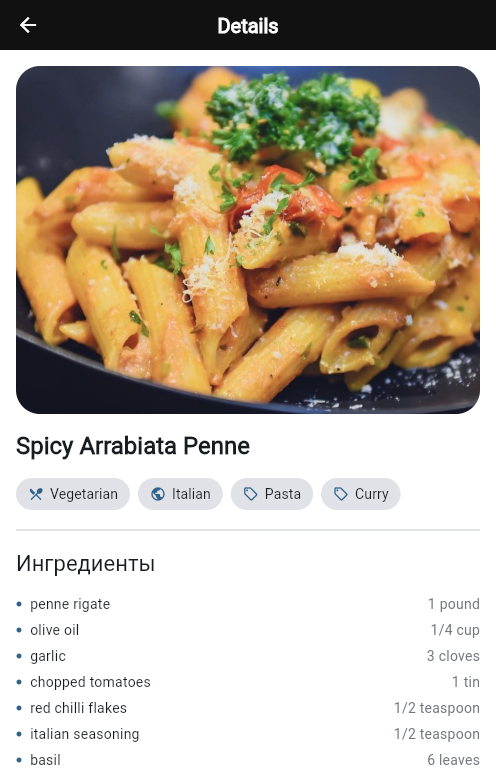

# Recipe Book

Учебное Flutter-приложение «Кулинарная книга» на данных открытого API
[TheMealDB](https://www.themealdb.com/api.php). Выполнено в рамках курса
«Кроссплатформенные средства разработки программного обеспечения».

## Возможности

- список рецептов, полученный с сервера (первый запрос);
- экран детальной информации о рецепте с загрузкой по `id` (второй запрос);
- управление состоянием на BLoC (`flutter_bloc`);
- внедрение зависимостей через `get_it`;
- навигация через `go_router`;
- логирование HTTP-запросов и событий BLoC через `talker`;
- pull-to-refresh, обработка ошибок и повторная загрузка;
- просмотр логов приложения из интерфейса (иконка жука в AppBar).

## Скриншоты

| Главный экран | Экран деталей |
| --- | --- |
|  |  |


## API

Базовый адрес: `https://www.themealdb.com/api/json/v1/1`

| Назначение | Метод | Параметры |
| --- | --- | --- |
| Список рецептов | `/search.php` | `s=` |
| Рецепт по id | `/lookup.php` | `i={idMeal}` |

Тестовый ключ `1` уже входит в базовый адрес, регистрация не требуется.

## Структура проекта

```
lib/
├── main.dart                     // точка входа
├── name.dart                     // корневой виджет приложения
├── di/di.dart                    // get_it, Dio, talker
├── data/
│   ├── dio/                      // настройка Dio и endpoints
│   ├── models/                   // модель Meal (+ meal.g.dart)
│   └── repositories/             // интерфейс и реализация репозитория
└── app/
    ├── extensions/               // вспомогательные расширения
    ├── features/
    │   ├── home/                 // первый экран + HomeBloc
    │   └── content/              // второй экран + ContentBloc
    ├── router/                   // go_router
    ├── theme/                    // цвета и ThemeData
    └── widgets/                  // общие виджеты
```

## Запуск

```bash
flutter pub get
flutter run
```


## Зависимости

`go_router`, `get_it`, `talker`, `talker_flutter`, `dio`, `equatable`,
`flutter_bloc`, `talker_dio_logger`, `talker_bloc_logger`, `json_annotation`;
для кодогенерации — `build_runner`, `json_serializable`.
